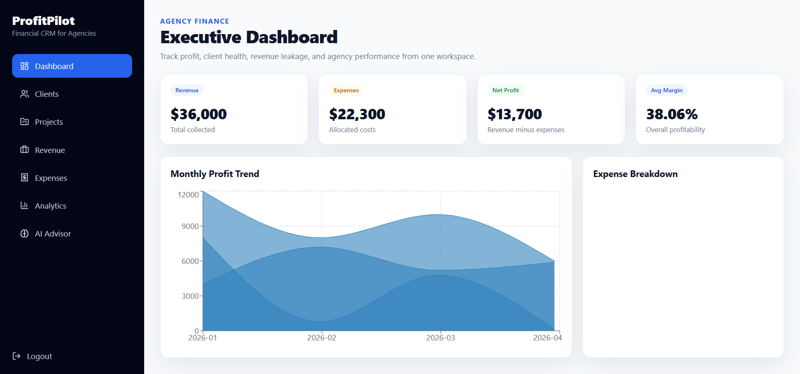

# Financial CRM for Agencies

> Phase 1 (API & session hardening), Phase 2 (financial correctness & audit engine), and Phase 3 (usable MVP & navigation redesign) are implemented. See the [Phase 1 guide](docs/PHASE1.md), [Phase 2 guide](docs/PHASE2.md), and [Phase 3 guide](docs/PHASE3.md). Release preparation and CI/deployment checks are the next phase (Phase 4).

A modern SaaS platform designed for agencies, consulting firms, freelancers, and service-based businesses to manage clients, projects, revenue, expenses, and profitability from a single workspace.

Unlike traditional CRMs that focus primarily on client management, Financial CRM for Agencies combines operational and financial data to help businesses understand which clients and projects generate the highest value and which ones negatively impact profitability.

---

## Overview

Agency owners often know how much revenue a client generates but lack visibility into the true cost of servicing that client.

Financial CRM for Agencies provides a centralized system for tracking:

* Clients
* Projects
* Revenue
* Expenses
* Team Operations
* Profitability Metrics
* Business Performance

The platform transforms raw financial and operational data into actionable business insights that support strategic decision-making.

---

## Key Features

### Multi-Tenant Workspace Management

* Create and manage agency workspaces
* Workspace-level data isolation
* Team member invitations
* Role-based access control
* Permission management

### Client Management

* Client profiles and contact management
* Client status tracking
* Industry categorization
* Revenue and profitability summaries
* Client lifecycle management

### Project Management

* Project creation and assignment
* Budget and deadline tracking
* Project status monitoring
* Resource allocation
* Profitability analysis per project

### Revenue Tracking

* One-time payments
* Monthly retainers
* Milestone payments
* Subscription revenue
* Revenue reporting and trends

### Expense Management

* Client-specific expenses
* Project expenses
* Team costs
* Software subscriptions
* Marketing and operational expenses
* Receipt tracking

### Profitability Engine

Automatically calculates:

* Client Revenue
* Client Expenses
* Client Profit
* Client Profit Margin
* Project Revenue
* Project Expenses
* Project Profit
* Project Profit Margin
* Monthly Profit Trends

### Analytics Dashboard

Real-time business intelligence including:

* Total Revenue
* Total Expenses
* Net Profit
* Profit Margins
* Top Performing Clients
* Loss-Making Clients
* Revenue Distribution
* Expense Breakdown
* Financial Health Metrics

### AI Profitability Advisor

Provides intelligent recommendations based on financial performance:

* Retain Clients
* Upsell Opportunities
* Renegotiation Suggestions
* Risk Identification
* Revenue Concentration Alerts
* Financial Health Insights

---

## Dashboard Preview

### Agency Performance Dashboard



---

## Tech Stack

### Frontend

* React.js
* Vite
* Tailwind CSS
* Shadcn UI
* Redux Toolkit
* React Query
* Recharts

### Backend

* Node.js
* Express.js
* MongoDB
* Mongoose
* JWT Authentication
* Bcrypt
* Zod Validation

### DevOps & Tools

* Docker
* MongoDB Atlas
* Cloudinary
* GitHub Actions
* Postman

---

## System Architecture

The backend follows a layered architecture to improve maintainability and scalability.

```text
Routes
  ↓
Middlewares
  ↓
Controllers
  ↓
Services
  ↓
Repositories
  ↓
Models
```

This separation of concerns simplifies testing, feature development, and long-term maintenance.

---

## Core Modules

### Authentication & Authorization

* JWT Authentication
* Refresh Tokens
* Secure Password Hashing
* Email Verification
* Password Recovery
* Protected Routes

### Role-Based Access Control

Supported roles:

* Owner
* Admin
* Manager
* Accountant
* Team Member

### Workspace Isolation

All resources are scoped to individual workspaces to support multi-tenant SaaS architecture.

---

## Database Models

### User

### Workspace

### Workspace Member

### Client

### Project

### Revenue

### Expense

### Invoice

### Payment

### AI Insight

### Notification

### Audit Log

---

## Business Metrics

### Client Profitability

```text
Client Profit = Revenue - Expenses
```

### Profit Margin

```text
Profit Margin = (Profit / Revenue) × 100
```

### Project Profitability

```text
Project Profit = Project Revenue - Project Expenses
```

### Financial Health Score

The platform evaluates overall agency performance using:

* Revenue Growth
* Profit Margins
* Expense Efficiency
* Client Distribution
* Revenue Concentration Risk

---

## API Modules

### Authentication

```http
POST /api/auth/register
POST /api/auth/login
POST /api/auth/logout
POST /api/auth/refresh-token
```

### Clients

```http
GET /api/clients
POST /api/clients
PATCH /api/clients/:id
DELETE /api/clients/:id
```

### Projects

```http
GET /api/projects
POST /api/projects
PATCH /api/projects/:id
DELETE /api/projects/:id
```

### Revenue

```http
GET /api/revenue
POST /api/revenue
```

### Expenses

```http
GET /api/expenses
POST /api/expenses
```

### Analytics

```http
GET /api/analytics/overview
GET /api/analytics/client-ranking
GET /api/analytics/project-ranking
```

---

## Security Features

* JWT Access Tokens
* Refresh Token Rotation
* Password Hashing with Bcrypt
* Request Validation
* Rate Limiting
* Role-Based Authorization
* Secure Environment Variables
* Centralized Error Handling

---

## Installation

### Clone Repository

```bash
git clone <repository-url>
```

### Backend Setup

```bash
cd server

npm install

npm run dev
```

### Frontend Setup

```bash
cd client

npm install

npm run dev
```

---

## Environment Variables

### Server

```env
PORT=5000

MONGO_URI=

JWT_ACCESS_SECRET=

JWT_REFRESH_SECRET=

ACCESS_TOKEN_EXPIRES_IN=15m

REFRESH_TOKEN_EXPIRES_IN=7d

CLIENT_URL=http://localhost:5173
```

---

## Future Enhancements

* Invoice Generation
* Stripe Integration
* Automated Financial Reports
* Advanced Forecasting
* Team Productivity Metrics
* Multi-Currency Support
* Budget Planning Tools
* Email Notifications
* Mobile Application

---

## Learning Outcomes

This project demonstrates:

* MERN Stack Development
* SaaS Architecture
* Multi-Tenant Systems
* Financial Analytics
* Role-Based Access Control
* REST API Design
* Dashboard Engineering
* Data Visualization
* Clean Backend Architecture

---

## Author

**Abdullah Niaz**

Software Engineer focused on building scalable web applications, SaaS products, and data-driven business systems.


### Financial reliability and database setup

Financial writes require a MongoDB replica set (or Atlas/sharded deployment). See [Phase 2 reliability fixes](docs/PHASE2-HARDENING.md) for setup requirements, verification, retry behavior, and remaining work.


### Demo and operations

See [demo login, email setup, backups, CI and release checks](docs/OPERATIONS.md) for the latest Phase 3/4 implementation.
